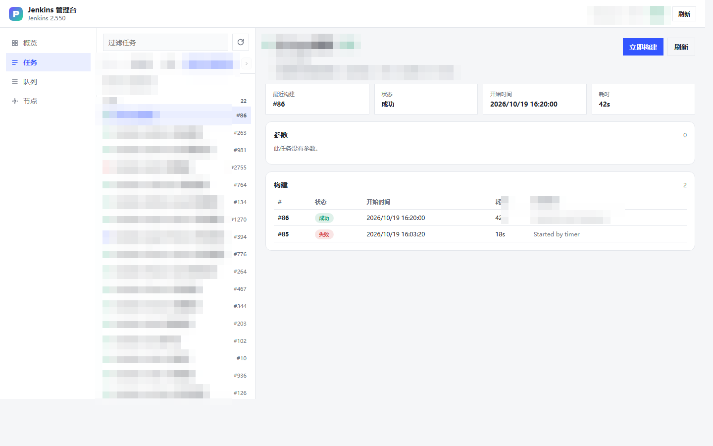
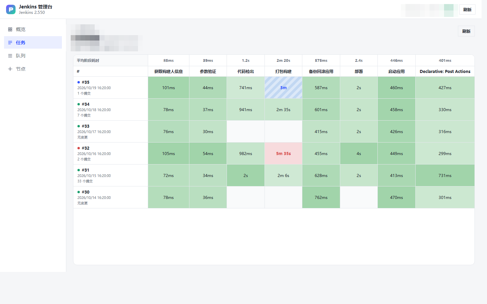

# Jenkins Console · DBX 插件

在 DBX 内管理 Jenkins 任务、构建、控制台日志、队列与节点。

- 插件 ID：`io.github.nixing178.jenkins`
- 当前版本：`0.10.1`（Active Choices 参数渲染为下拉框）
- 形态：Go Sidecar + Vue3 静态工作台
- 许可证：Apache-2.0

## 目录结构

```
manifest.json              插件身份、连接表单、贡献点
dbx-plugin.toml            打包配置（后端 + include）
index.html                 Vite 入口
src/                       Vue3 工作台源码
ui/                        构建产物（pnpm build 生成，打包时使用）
backend/
  main.go                  Sidecar 入口（JSON-RPC）
  internal/jenkins/        Jenkins 客户端与纯函数（TDD 覆盖）
  third_party/             内置 Go SDK（离线构建用）
assets/                    插件与连接图标
dist/                      .dbxp 打包产物
```

## 环境要求

| 工具 | 版本 |
| --- | --- |
| Node.js | >= 22 |
| pnpm | 10.x |
| Go | 1.22 |
| DBX | >= 0.6.43（本机 0.6.47） |

## 安装依赖

```powershell
cd E:\DBX插件开发\Jenkins
pnpm install
```

> pnpm 10 默认不执行依赖的 postinstall。若遇到 esbuild 的 `EBUSY` 校验失败，使用 `pnpm install --ignore-scripts`；esbuild 的 Windows 二进制来自 `@esbuild/win32-x64`，不受影响。

## 构建 UI

```powershell
pnpm build        # vue-tsc 类型检查 + vite 单文件构建，输出到 ui/
```

## 测试（TDD）

> 测试按 TDD 红→绿推进，历史红/绿证据见 [`docs/test-evidence.md`](./docs/test-evidence.md)。

后端全量：

```powershell
$env:PATH = "<Go 安装目录>\bin;" + $env:PATH
cd E:\DBX插件开发\Jenkins\backend
go test ./... -v
```

前端（Vitest）：

```powershell
cd E:\DBX插件开发\Jenkins
pnpm test
```

## 真实 Jenkins E2E

已在临时 Jenkins **2.586**（Java 21，`/jenkins` 前缀，CSRF 开启）跑通：

- 连接 / whoami / 任务 / 参数 / 构建 / 控制台 / 停止 / 队列 / 节点 / 概览
- 任务按 Jenkins 原生 Views 分组（all/Builds/Ops 已实测）
- Pipeline 任务支持阶段视图：构建 × stage 矩阵、平均耗时、失败/进行中/跳过着色；行首提交数悬停/点击展开变更浮层（哈希、信息、作者），可跳转构建详情
- 构建详情的变更记录：提交时间、改动文件数、点哈希复制完整 commit id；默认最新在前并折叠 8 条，多行提交可展开正文，无变更时给空态提示
- 无参与带参构建、只读拦截、MCP `list_jobs`
- 完整步骤与实测输出：[`docs/e2e-jenkins.md`](./docs/e2e-jenkins.md)
- 脚本：[`scripts/e2e-jenkins.js`](./scripts/e2e-jenkins.js)

## 视图 / 任务管理

连接处于**可写模式**（关闭「只读模式」）时，可以在 DBX 内直接管理 Jenkins 配置：

| 操作 | 入口 | 说明 |
| --- | --- | --- |
| 新建任务 | 任务列表顶部 `＋` | 自由风格 / Pipeline；在左侧当前文件夹内创建 |
| 编辑任务 | 任务详情右上「编辑」 | 表单改名称、描述、启用状态、Pipeline 脚本；高级页签可直接改 config.xml |
| 删除任务 | 任务详情右上「删除」 | 需手动输入任务名确认；同时删除全部构建历史 |
| 新建视图 | 面包屑右侧 `＋` | ListView；可勾选任务、填包含正则、递归子文件夹 |
| 编辑视图 | 面包屑右侧 `⋯` | 表单改名称、描述、任务清单、包含正则；非 ListView 仅支持 XML |
| 删除视图 | 面包屑右侧 `⋯` | 需手动输入视图名确认；不会删除视图内任务 |

实现要点：

- 编辑配置采用 **XML 局部改写**，只替换 `description` / `disabled` / `script` / `jobNames` 等目标节点，SCM、构建步骤、插件字段原样保留。
- **视图改名**走 `POST /view/<name>/configSubmit`（`config.xml` 提交路径明确拒绝覆盖名称），并提交完整结构化表单，避免 Jenkins 全量重建时清空任务与列；改名后再用原 XML 回写一次，恢复 `properties` / `jobFilters` 等表单覆盖不到的字段。
- Pipeline 脚本与 config.xml 使用内嵌代码编辑器：Groovy / XML 语法高亮、行号、当前行高亮，`Tab` / `Shift+Tab` 缩进，右上「展开」切全屏编辑（`Esc` 先收起编辑器，再按才关闭窗口）。零外部依赖，产物只增约 1 KB。
- 表单只提交**发生变化的字段**，未修改项不会被重写。
- 所有写操作复用后端的只读守卫、CSRF crumb 刷新重试与权限错误映射。
- **新建任务后列表自动刷新**：在自定义 ListView 下新建任务，会把任务追加进该视图的 `jobNames`（只追加、以服务端最新清单为基线，不动描述 / 列 / 过滤规则），随后刷新列表并选中；正则视图已匹配时不产生写请求；非 ListView（如聚合视图）只提示「已创建，但未能加入视图」。
- Jenkins 返回 HTML 错误页时，优先提取页面里的可读原因（任务重名、非法字符等），直接显示「请求被 Jenkins 拒绝：<原因>」；只有 500 Oops 页这类没有原因的错误才收敛为「HTML error page (HTTP xxx)」并附上 `Logging ID`，绝不把整页 HTML 塞给用户。
- 任务 / 视图名称在前端与后端都按 Jenkins `NameValidator` 校验：`/ \ ? # % * : < > | & ; ! @ $ ^ [ ] "` 先行拦截，避免落到 Jenkins 的 400 / 500。

所需 Jenkins 权限：`Item/Create`、`Item/Configure`、`Item/Delete`、`View/Create`、`View/Configure`、`View/Delete`。

## 批量构建

任务列表顶部「多选」按钮（仅可写连接显示）进入多选模式，一次触发一批任务，不用再逐个切任务页：

- 行首出现复选框，点整行即勾选/取消；底部操作条为 `已选 N · 全选可见 · 清空 · 构建所选(N)`，`×` 退出多选。
- 单次上限 50 个（够发版用，又能挡住「全选几百个」的误触）；文件夹不参与多选，全选只作用于当前过滤结果。
- **跨视图选择**：勾选不随视图切换清空，底部显示 `已选 7（3 个在其它视图）`；全选与 Shift 连选仍只作用于当前可见列表。
- **确认后自动退出多选**：点「构建所选」先做一次预检（实时状态 + 参数定义），确认执行后立即退出多选，结果弹窗照常保留重试入口。
- **支持带参数构建（仅开关）**：确认弹窗只列所选任务的 **Boolean 开关**并集（`SKIP_CODE_CHECKOUT`、`SKIP_BUILD` 这类批量发版要统一勾的），填一次全批生效；`MODULE_NAME` / `BRANCH_NAME` / `STATUS` 这类任务级差异化参数**不展示**，各任务使用自己的默认值。后端只把参数应用到「任务自己声明过」的参数名上，无参任务仍走 `/build`。同名开关以第一个任务的默认值为准；File 参数不支持批量上传。
- **分批执行**：每 10 个一批串行触发，弹窗显示 `正在触发 12/30…` 与确定进度条；单批 60s 超时只影响这一批，连续 2 批失败才中止剩余（标记「未执行」），已触发的部分不会因为整批超时而变成不可知状态。
- 确认弹窗列出待构建任务与当前状态，并带「跳过正在构建 / 排队中的任务」（默认勾选）；行尾 `×` 可临时把某个任务从本批剔除（剔除后参数并集同步重算）。
- 结果弹窗给出「已触发 / 跳过 / 失败」汇总，失败与跳过逐条列原因（`无权限` / `任务不存在` / `只读连接` / `Jenkins 拒绝` / `请求超时`），错误可悬停看全文；有失败时出现「重试失败项 (K)」，直接重跑失败的 K 个，不用重选。
- 支持 Shift 点击范围连选。
- 后端一次 RPC 完成：**并发读**任务信息（默认 4）、**串行触发**——避免并发首写同时抢 CSRF crumb，队列序号也与任务顺序对齐；单条失败不中断其余。
- 构建后左侧圆点与构建号静默补刷（立即一次 + 800ms 再一次），选择保留便于重试失败项。
- 只读连接不显示多选入口，切换为只读时自动退出多选；`jenkins/batchBuild` 在只读下直接拒绝且**不发任何请求**。
- 预检失败（网络/权限）不堵死构建：回退到列表缓存状态 + 默认参数，弹窗顶部提示「实时状态读取失败」。
- 预览页：`pnpm dev` 打开 [`/batch-preview.html`](./batch-preview.html)（`?theme=dark` 切深色），可切换读取中 / 确认 / 执行 / 结果四态。


## 页面前进 / 后退

鼠标侧键（后退 / 前进）可以逐屏回退与复原；topbar 品牌名右侧有一对等价箭头，不可用时置灰。

- **历史粒度**：侧栏切页、视图 tab 切换、进出文件夹、切换任务、打开构建详情 / 阶段视图，每一步都占一格，最多保留 50 步。
- **页面内「返回」= 后退一步**：构建详情 / 阶段视图的返回按钮与侧键同义，前进还能回到刚看过的构建。
- **双通道**：宿主把侧键当浏览器命令时走 `history` / `popstate`；宿主不处理时由页面自行捕获 `mousedown` / `mouseup`（`button` 3 / 4）。两条通道用 90ms 兜底窗口 + 150ms 去抖互相让路，一次按键只走一步。
- **弹窗优先**：有弹窗（参数、任务 / 视图编辑、删除确认、停止确认、批量构建）时按后退只收弹窗，不消耗页面历史；写操作进行中则只吞掉这次按键。
- **退化**：`file://` 等 `pushState` 不可用的环境自动降级为页面内历史，顶部箭头照常使用。
- 回放按页补数据：切页走进入刷新，任务 / 构建 / 阶段精确定位到原来的任务与构建号，不依赖「自动选中第一个」。

## 自动刷新

| 视图 | 触发条件 | 间隔 | 停止条件 |
| --- | --- | --- | --- |
| 概览 | 停留在概览页 | 有执行器被占用或队列非空 5s；全空闲 30s 兜底 | 离开概览页 |
| 构建列表 | 最近 20 次构建里有构建中，或刚触发构建 | 3s | 最后一条构建结束 / 新构建已出现 |
| 构建详情 | 当前构建仍在跑 | 3s | 构建结束 |
| 阶段视图 | 存在构建中或 `IN_PROGRESS` 的 stage | 5s | 全部 stage 结束 |
| 队列 | 停留在队列页 | 5s | 离开队列页 |

- 概览页一轮同时拉聚合数字（排队数 / 节点在线 / 静默模式）与执行器明细，两侧一起收敛；一个接口失败不丢另一份数据，但失败仍计入护栏。
- 概览页空闲档是「兜底」而非「停止」：外部触发的构建、排队项进出、节点上下线在没人操作时也会自己冒出来。

- 轮询是**串行**的：上一轮请求返回后才排下一轮，不会并发叠加；每轮用 15s 短超时，避免慢请求把后续轮次拖死。
- **连续 3 次失败自动暂停**并提示「自动刷新已暂停」；点「刷新」或切换视图即恢复。失败不再无限重试。
- 页面隐藏时停掉轮询，回到前台**立即补一轮**，不从后台空转。
- 左侧任务列表不常驻轮询：触发构建后立即补刷、800ms 再补一次，新构建出现与轮询停止时各补一次，从构建详情 / 阶段视图返回列表也各补一次。
- **进入页面补刷一次**：侧栏切页（概览 / 任务 / 队列 / 节点）、从详情或阶段视图返回、从其它标签页回到前台，都会按当前页刷一次；任务页保留所在文件夹，静默刷新任务列表与选中任务的构建列表，不闪「加载中」。换页必刷，同一页 2s 内重复点击只发一次请求。
- 刚触发的构建会被持续跟踪到出现在列表里（最长 120s，排队过久自动放弃，放弃时也补刷一次列表）。
- 静默刷新不闪「加载中…」占位，请求失败也不弹错误横幅；手动刷新会重置计时，避免刚点完又自动刷一次。
- 面板标题旁的徽章显示「自动刷新中 · 上次更新 12:31:05」：请求中圆点加速脉冲、等待下一轮时呼吸、连续失败后变琥珀色「已暂停」，悬停可看间隔与护栏规则。
- 手动刷新按钮三态：刷新 → 刷新中…（禁用）→ 已更新（1.5s 后复原）。
- 新增构建或状态翻转到的新行，左侧短绿条高亮 1.6s，状态 pill 同时轻闪一次。

## 打包

```powershell
$env:PATH = "<Go 安装目录>\bin;" + $env:PATH
cd E:\DBX插件开发\Jenkins
node scripts/check-version.mjs          # manifest / package.json / main.go / UA 版本必须一致
pnpm build
npx --yes @dbx-app/plugin-cli@0.1.9 package .
node scripts/verify-sidecar-identity.mjs dist\dbx-plugin-jenkins.exe   # 校验后端 identity
```

> **版本号必须同步**：DBX 会比对 `manifest.version` 与 sidecar `plugin/initialize` 返回的版本，
> 不一致会直接拒绝启动（`backend identity ... does not match manifest`）。
> 版本号分散在 `manifest.json`、`package.json`、`backend/main.go`、`backend/internal/jenkins/client.go` 的 User-Agent 四处，
> 由 `check-version.mjs` 与 `verify-sidecar-identity.mjs` 双重把关。

产物：

```
dist/io.github.nixing178.jenkins-0.4.0-windows-x64.dbxp
dist/io.github.nixing178.jenkins-0.4.0-windows-x64.artifact.json
```

## 发布到 DBX 插件商店

商店目录在 [`t8y2/dbx-store`](https://github.com/t8y2/dbx-store)，发布分两步：作者发候选包，维护者审核签名。

**1. 发候选 Release（CI 自动构建）**

`ui/` 与 `dist/` 不进 Git，候选包由 CI 从源码重建，因此本地 `dist/` 的哈希不能用于上架。

```bash
git tag v0.4.0
git push origin main --tags
# GitHub → Releases → Draft a new release → 选 v0.4.0 → Publish
```

`.github/workflows/plugin-release.yml` 会复用官方 `plugin-release-reusable.yml`，自动产出并上传三个资产：

| 资产 | 说明 |
| --- | --- |
| `io.github.nixing178.jenkins-<version>-windows-x64.dbxp` | 未签名候选包 |
| `io.github.nixing178.jenkins-<version>-windows-x64.artifact.json` | 目标平台、sha256、size |
| `release-candidates.json` | 汇总，供商店同步器读取 |

**2. 提 catalog PR**

向 `t8y2/dbx-store:main` 提交单个 PR，只加两个文件：

- `publishers/nixing178.json`（首次上架）
- `candidates/io.github.nixing178.jenkins.json`（`sha256`/`size` 必须取自 CI 产出的 `.artifact.json`）

维护者评论 `/sign` 后，签名工作流会回写 `plugins/io.github.nixing178.jenkins.json` 与 `catalog/index.json`，合并即上架。
签名私钥由商店维护，作者不接触。

> 已签名版本不可覆盖：任何改动都必须升 semver，并同步四处版本源（见上节）。

## 本地安装

> 面向最终用户的完整说明（校验和、验收清单、常见问题）：`docs/安装说明书-0.7.5.txt`。

1. DBX → 插件中心 → 设置 → 打开「允许安装未签名开发包」。
2. 插件中心 → 安装 → 从文件 → 选择 `dist/io.github.nixing178.jenkins-0.7.5-windows-x64.dbxp`。
3. 新建连接，类型选 **Jenkins**，填写地址、端口、用户名与 API Token。
4. 从 `com.anjun.jenkins` 旧版升级时：两者是不同插件，需先在插件中心卸载旧版，再安装新版。

> 若启动时报 `Plugin 'io.github.nixing178.jenkins' initialization failed: backend identity 'x' does not match manifest 'y'`，
> 说明包内后端版本与 manifest 不一致（0.2.0 曾有此问题）。改用 0.3.0+ 的包，并先卸载旧版。
> 插件 ID 于 0.3.0 从 `com.anjun.jenkins` 迁移到 `io.github.nixing178.jenkins`，DBX 视为两个独立插件，
> 旧版的 Jenkins 连接不会自动迁移，需在新插件下重新创建。

## 连接配置

| 字段 | 说明 |
| --- | --- |
| 协议 | HTTPS（默认）/ HTTP（内网） |
| IP / 域名 + 端口 | Jenkins 控制器地址，默认 `8080` |
| 上下文路径 | 部署在子路径时填写，如 `/jenkins` |
| 用户名 + API Token | 在 Jenkins「用户设置 → API Token」生成；留空表示匿名只读 |
| 只读模式 | 默认开启，后端会拒绝触发/停止/取消队列 |
| 跳过 TLS 证书校验 | 仅用于自签证书的内网实例 |

## AI / MCP 工具

在「插件中心 → 已安装 → 内置 AI 工具」开启后，AI 可使用：

| 工具 | 读写 | 说明 |
| --- | --- | --- |
| `list_jobs` | 只读 | 列出根目录/文件夹任务，支持名称过滤 |
| `get_job` | 只读 | 任务详情与参数定义 |
| `list_builds` | 只读 | 最近构建列表 |
| `get_build` | 只读 | 单次构建详情、变更集、产物 |
| `get_console_log` | 只读 | 增量控制台日志（用 `nextStart` 续读） |
| `list_queue` | 只读 | 队列与阻塞原因 |
| `list_nodes` | 只读 | 节点状态与执行器 |
| `trigger_build` | 写 | 触发构建（可有参），宿主逐次确认 |
| `stop_build` | 写 | 停止构建（destructive） |
| `cancel_queue_item` | 写 | 取消排队（destructive） |

只读连接下，3 个写工具不会出现在工具列表中；后端仍会二次拦截。

## 当前进度

| 里程碑 | 状态 |
| --- | --- |
| M0 脚手架 / manifest / 打包链路 | 已完成 |
| M1 连接、认证、CSRF、错误映射 | 已完成（75 后端用例 + 6 前端用例全绿） |
| M2 任务、构建、控制台 | 已完成（102 后端用例 + 18 前端用例全绿，含 sidecar 冒烟） |
| M3 队列、节点、概览 | 已完成（111 后端用例全绿，M3 端点冒烟通过） |
| M4 MCP 工具面 | 已完成（120 后端用例全绿，10 工具冒烟通过） |
| M5 打包验收 | E2E 已完成（Jenkins 2.586 全链路通过）；待本机安装验收 |
| M6 视图 / 任务 CRUD | 已完成（84 jenkins + 45 rpc 用例；真实 Jenkins 2.586 建/改/删/重命名/只读拦截 E2E 通过） |
| M7 运行时自动刷新 | 已完成（构建列表 3s / 阶段视图 5s 静默轮询，构建结束自动停止） |
| M8 触发后跟踪新构建 | 已完成（触发即补刷 + 持续跟踪至新构建出现，120s 上限；114 前端用例全绿） |
| M9 自动刷新治理 | 已完成（构建详情/队列补轮询、失败护栏、前台恢复、控制台内存上限；184 前端用例全绿） |
| M10 刷新提示与反馈 | 已完成（时间戳徽章四态、按钮三态、行变化高亮；201 前端用例全绿） |
| M11 构建详情变更列表 | 已完成（提交时间/文件数/正文展开/折叠/复制；时间与文件数由后端归一化，263 前端用例全绿） |
| M12 任务批量构建 | 已完成（0.8.0：多选触发、参数默认值、跳过构建中/排队中、逐条结果；176 后端用例 + 315 前端用例全绿） |
| M12b 批量构建优化 | 已完成（0.8.1：分批进度 10/批、连续 2 批失败中止、失败项一键重试、原因文案 8 种、清单就地剔除、Shift 连选；332 前端用例全绿） |
| M13 批量构建 v3 | 已完成（0.9.0：`jenkins/batchInspect` 预检、共享参数一次填写全批生效、跨视图选择与「含 M 个其它视图」提示、确认后退出多选；176 后端 + 336 前端用例全绿） |
| M13b 参数区只留开关 | 已完成（0.9.1：共享参数按类型过滤为 Boolean，其余参数各任务用默认值；移除 conflicts 机制；336 前端用例全绿） |
| M13c 概览页自动刷新 | 已完成（0.9.2：活跃 5s / 空闲 30s 双档、概览数字与执行器明细一轮并行、概览页徽章与按钮三态；344 前端用例全绿） |
| M14 Active Choices 参数 | 已完成（0.10.1：`org.biouno.unochoice.*` 参数从任务 config.xml 的脚本里提取静态选项，参数区渲染为下拉框；动态脚本与取不到选项时仍回退文本框） |

> 任务列表已按 Jenkins 原生 Views 分组：顶部 Tab 切换视图，视图内分「文件夹 / 任务」两组。
> Tab 溢出时左右箭头滚动，当前视图自动居中；打开视图自动选中首个任务；左栏宽 320px。
> 当前测试基线：176 后端用例（`go test ./...`）+ 344 前端用例。
>
> Pipeline 创建依赖 Jenkins 的 `workflow-job` / `workflow-cps` 插件；实例未安装时 Jenkins 返回 500，插件会给出去敏的 HTML 错误提示，不会创建半成品任务。



